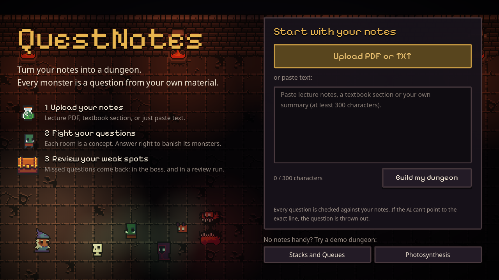
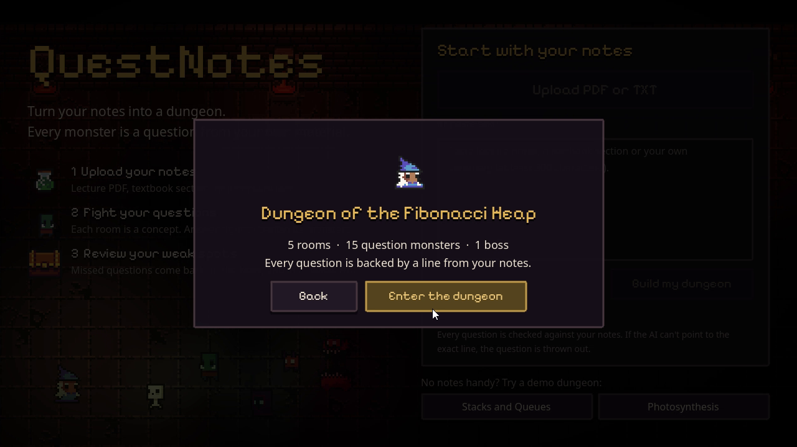
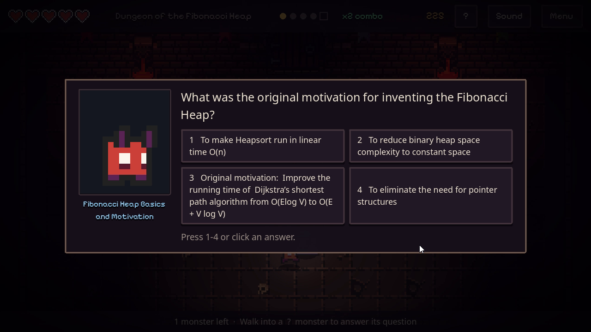
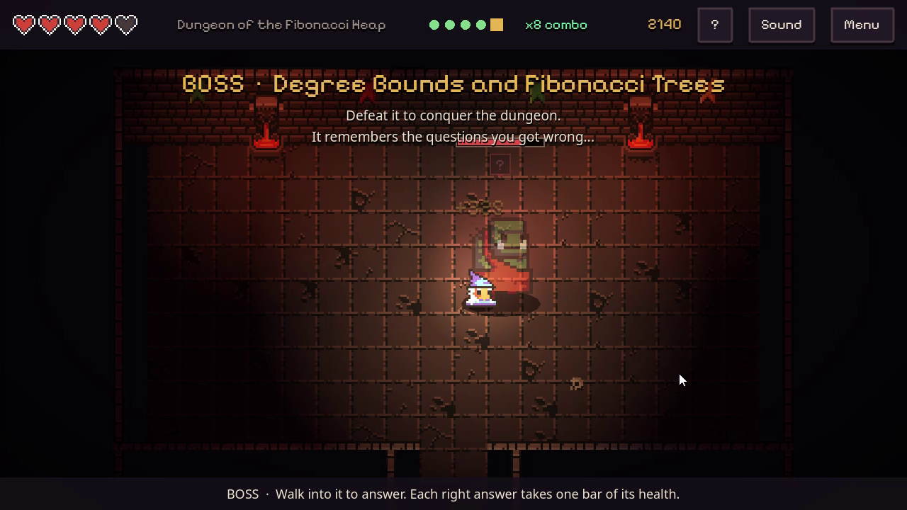
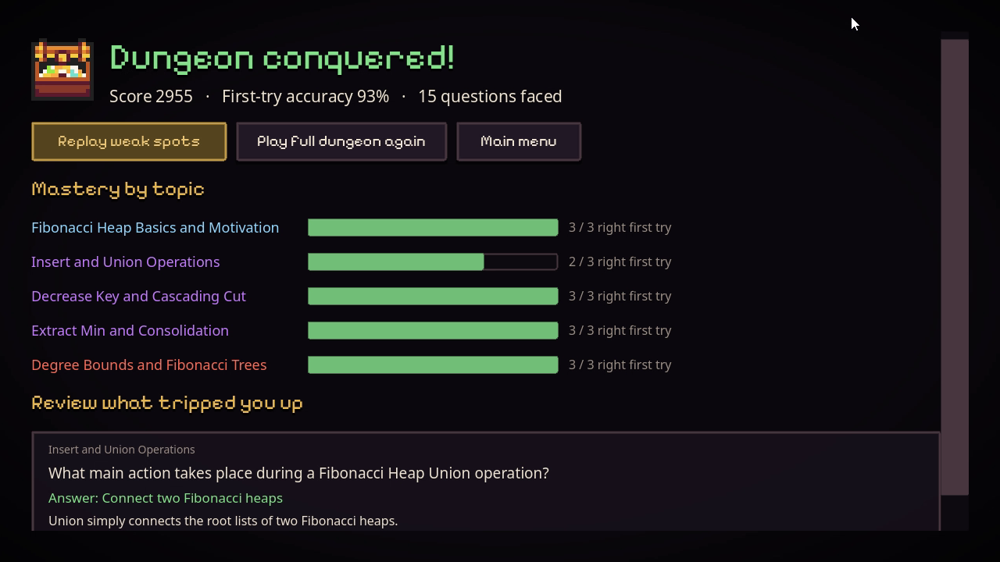

# QuestNotes

Upload your notes. Get a dungeon. Every enemy is a question from *your* material.

Built for SLAY HACKS 2026.



| Notes in, dungeon out | Every monster is a question |
|---|---|
|  |  |
|  |  |

## How it works
1. Student pastes notes or uploads a PDF/TXT.
2. Gemini picks the key concepts and writes multiple-choice questions, each with a
   **word-for-word source sentence** from the notes.
3. **Grounding check** (`backend/grounding.py`): every source sentence is matched
   against the uploaded text. Questions whose quote isn't really in the notes are
   dropped, so the game never quizzes on something the notes don't say.
4. Godot builds the dungeon: one room per concept, one enemy per question, the
   hardest concept is the boss.
5. Wrong answer → AI hint + the exact line from your notes.

## Repo layout
```
backend/           FastAPI + Gemini
  main.py          API endpoints
  llm.py           prompts + Gemini calls
  grounding.py     source-quote check, choice shuffling
  schema.py        deck/question shapes (shared contract with Godot)
  samples_src/     hand-written sample decks (source notes + questions)
  decks/           built sample decks (run build_samples.py)
game/              Godot 4.5 project (web export target)
  scripts/game_state.gd   autoload: deck, answers, score, API URL
  scripts/api.gd          autoload: HTTP calls to the backend
  scripts/main_menu.gd    samples, paste notes, PDF/TXT upload
  scripts/dungeon.gd      room building, play loop, HUD, juice
  scripts/enemy.gd        question monsters + boss
  scripts/question_panel.gd  answer UI, hints with source line
  scripts/results.gd      mastery, review, replay weak spots
  scripts/room_view.gd    paints rooms from the 0x72 tileset
  scripts/art.gd          sprite/animation/light helpers
  scripts/sfx.gd          autoload: sound effects + ambient loop
  assets/                 sprites (CC0), fonts (OFL), generated sfx
  tests/autoplay.tscn     automated full playthrough with screenshots
tools/export_samples.py  copies sample decks into the game
tools/make_sfx.py        generates all sound effects
tools/pack_atlas.py      packs sprites into one atlas (fewer draw calls)
CREDITS.md         asset and font credits
render.yaml        one-click deploy config for Render
```

## Run the backend locally
```bash
cd backend
pip install -r requirements.txt
uvicorn main:app --reload
```
Open http://127.0.0.1:8000/docs to try the endpoints.

Without a key it runs in **mock mode** (`/generate` returns a sample deck), so the
game can be built and tested offline. To turn AI on:
```bash
export GEMINI_API_KEY=your_key_here      # Windows PowerShell: $env:GEMINI_API_KEY="..."
```
Get a free key at https://aistudio.google.com. Never commit it.

The backend tries several current Flash models and keeps the first that works.
To force one, set `GEMINI_MODEL` to a current Flash
model from https://ai.google.dev/gemini-api/docs/models.

## API
| Method | Path | What |
|---|---|---|
| GET | `/health` | status, whether AI is on |
| GET | `/decks` | list sample decks |
| GET | `/decks/{id}` | one sample deck |
| POST | `/generate` | form field `text`, or multipart `file` (PDF/TXT) → deck |
| POST | `/hint` | wrong answer → short hint + source line |

Limits: 300–30,000 characters of notes, 8 MB upload, 8 generations per IP per hour.
Scanned PDFs (no selectable text) are rejected with a message to paste text instead.

## Deck format
```json
{
  "id": "...", "title": "The LIFO Labyrinth", "subject": "Stacks and Queues",
  "dropped_ungrounded": 0,
  "concepts": [{
    "id": "c1", "name": "...", "summary": "...", "difficulty": 1,
    "questions": [{
      "id": "c1q1", "prompt": "...", "choices": ["a","b","c","d"],
      "answer_index": 2, "explanation": "...",
      "source_quote": "exact sentence from the notes", "grounded": true
    }]
  }]
}
```

## Deploy (Render, free)
1. Push this repo to GitHub.
2. Render → New → Blueprint → pick the repo (it reads `render.yaml`).
3. Add `GEMINI_API_KEY` in the service's Environment tab.
4. Free instances sleep after ~15 min idle; the first request then takes up to a
   minute. The game shows a "waking up the dungeon" screen for that.

## Built with
Godot 4.5, FastAPI, Google Gemini API, pypdf. Art: 0x72 DungeonTileset II (CC0). See CREDITS.md.
Developed with the help of AI coding tools.
